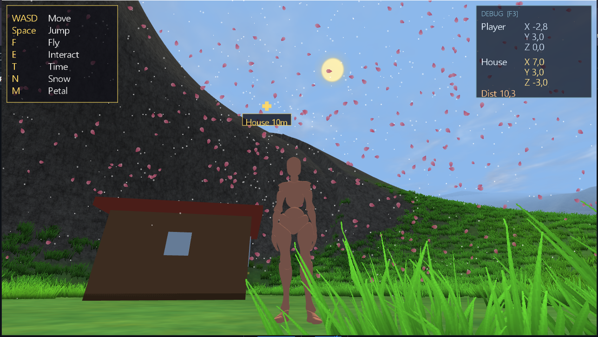
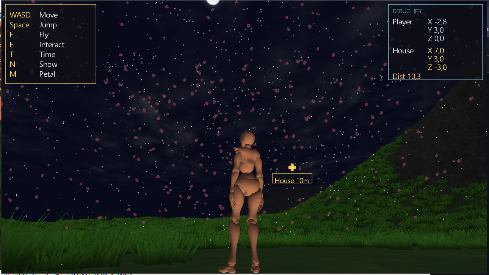
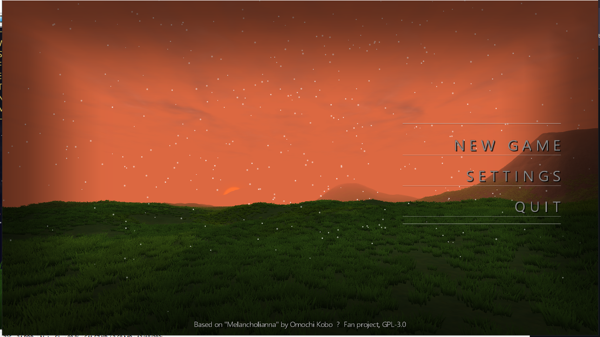
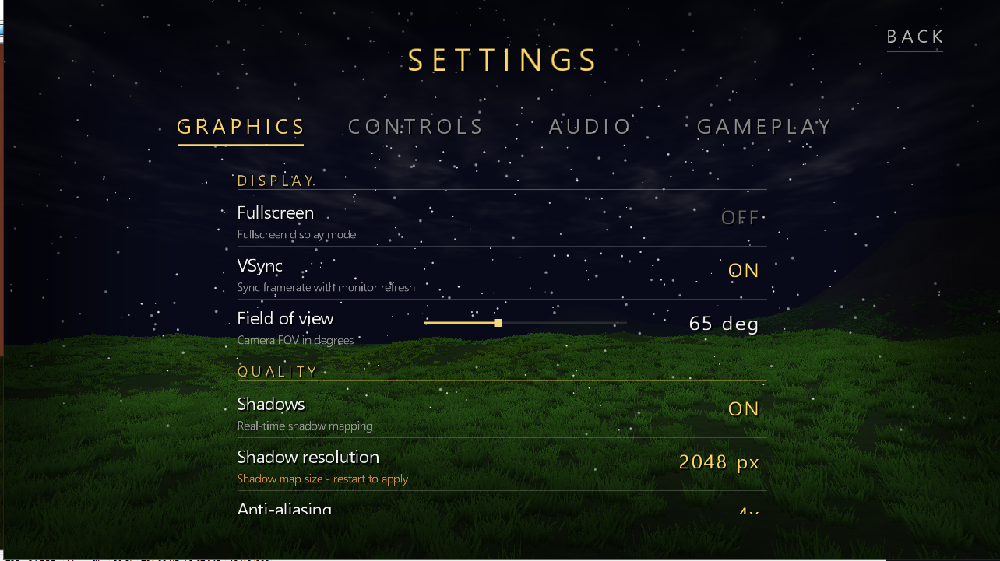

<div align="center">

# Melancholianna 3D

### *A fan-made 3D Adventure RPG*

Unofficial fan project based on **Melancholianna** (メランコリアンナ)  
by [Omochi Kobo (おもち工房)](https://www.omochikobo.com/)

[](LICENSE)
[](https://openjdk.org/)
[](https://www.lwjgl.org/)
[](https://www.opengl.org/)
[]()

</div>

---

## ⚠️ Disclaimer

> This is an **unofficial fan-made project**. It is **not** affiliated with,
> endorsed, sponsored, or approved by **Omochi Kobo** or the original creators
> of *Melancholianna*. All rights to the original work, characters, and setting
> belong to their respective owners.
>
> This project is a **technical showcase** — an independent game engine built
> from scratch to demonstrate rendering, animation, and gameplay systems.
> It is distributed freely under GPL-3.0-or-later for educational purposes.

---

## ✨ Features

<table>
<tr>
<td width="50%" valign="top">

### 🌍 World
- **Procedural infinite terrain** with chunk streaming
- Multi-texture splatmap blending (grass / rock / sand / snow)
- Grass tuft instancing with wind sway
- Frustum culling per chunk
- Dynamic chunk load budget (~6ms/frame)

</td>
<td width="50%" valign="top">

### 🌅 Atmosphere
- **Dynamic day/night cycle**
- Real-time shadow mapping (2048² ortho)
- Multi-layer scrolling clouds
- Stars with night fade-in
- Snow & sakura petal particle systems

</td>
</tr>
<tr>
<td width="50%" valign="top">

### 🎮 Gameplay
- Third-person camera with collision ray-march
- WASD movement, jump, run, and fly modes
- Placeable objects (banner, house) with collision
- Waypoint indicator for navigation
- Debug HUD (F3)

</td>
<td width="50%" valign="top">

### 🎨 Rendering
- Skinned character with crossfade animation
- Terrain AO baking at chunk generation
- Custom 2D GUI batching renderer
- Screens: menu, settings, HUD, toast
- MSAA, VSync, FOV, and quality settings

</td>
</tr>
</table>

---

## 📸 Screenshots

<div align="center">

| Sunset | Night |
|:-:|:-:|
|  |  |

| Main Menu | Settings |
|:-:|:-:|
|  |  |

</div>

> *Screenshots coming soon — run the game to capture your own.*

---

## 🛠️ Tech Stack

| Layer | Technology |
|---|---|
| **Language** | Java 17+ |
| **Build** | Gradle (with wrapper) |
| **Windowing** | GLFW via LWJGL 3 |
| **Graphics** | OpenGL 3.3 Core Profile |
| **Audio** | OpenAL + stb_vorbis |
| **Math** | JOML |
| **Model format** | glTF 2.0 (`.glb`) — custom loader |
| **Shader version** | GLSL 330 core |

---

## 🚀 Build & Run

### Prerequisites

- **JDK 17** or newer ([Adoptium Temurin](https://adoptium.net/))
- **Git** (to clone)
- A GPU with **OpenGL 3.3** support

### Clone

```bash
git clone https://github.com/pmgdev64/Melancholianna-Fanmade.git
cd Melancholianna-Fanmade
